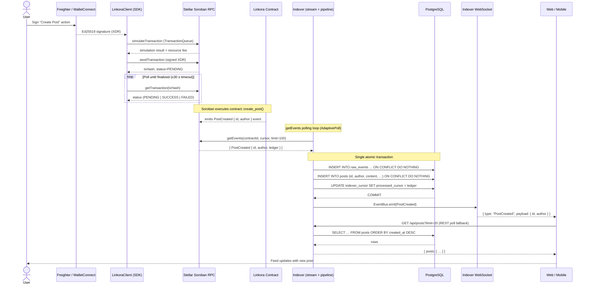
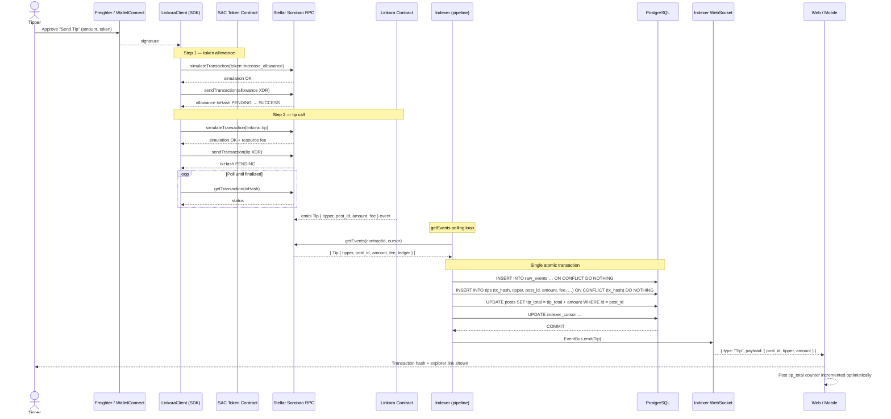
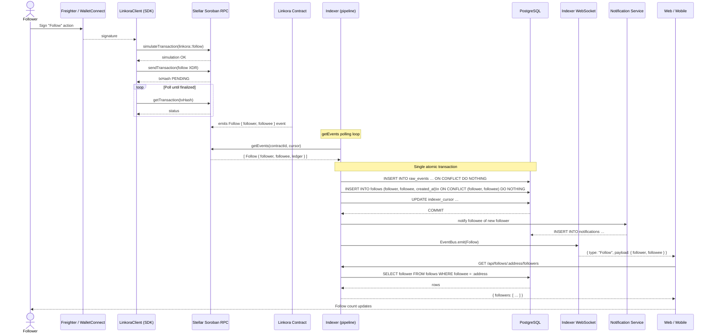
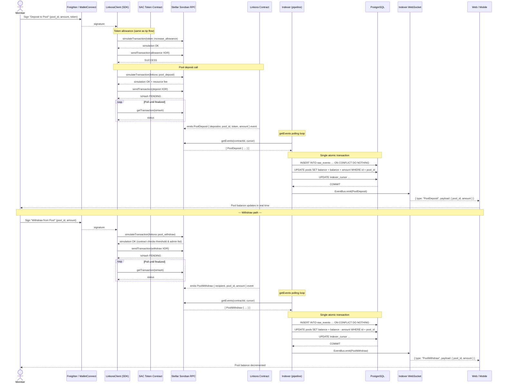

# Linkora System Architecture

This document describes the **component topology** and the **end-to-end data flow** for the Linkora SocialFi platform built on Stellar / Soroban.

---

## Table of Contents

1. [Component Overview](#1-component-overview)
2. [Package and Service Map](#2-package-and-service-map)
3. [Request Lifecycle](#3-request-lifecycle)
   - [3.1 Shared Pipeline Invariants](#31-shared-pipeline-invariants)
   - [3.2 Post Creation Flow](#32-post-creation-flow)
   - [3.3 Tip Flow](#33-tip-flow)
   - [3.4 Follow Flow](#34-follow-flow)
   - [3.5 Pool Deposit / Withdraw Flow](#35-pool-deposit--withdraw-flow)
4. [Error Paths and Retry Logic](#4-error-paths-and-retry-logic)
5. [Eventual Consistency Guarantees](#5-eventual-consistency-guarantees)
6. [Authentication](#6-authentication)

---

## 1. Component Overview

```
┌─────────────────────────────────────────────────────────────────┐
│  Soroban Smart Contract  (packages/contracts)                   │
│  Profiles · Posts · Tips · Pools · Governance · Moderation      │
└───────────┬────────────────────────┬────────────────────────────┘
            │ contract calls (XDR)   │ events (Stellar RPC getEvents)
            ▼                        ▼
┌──────────────────────┐   ┌─────────────────────────────────────┐
│  SDK (packages/sdk)  │   │  Indexer (services/indexer)         │
│  LinkoraClient       │   │  PostgreSQL · full-text search API  │
│  TransactionQueue    │   └──────────┬──────────────────────────┘
│  RpcServerAdapter    │              │  REST / WebSocket
│  LinkoraEventSub.    │              ▼
└──────────┬───────────┘   ┌──────────────────────────────────────┐
           │               │  Web (apps/web) · Mobile (apps/mobile)│
           └──────────────►│  Next.js 15 · Expo / React Native    │
                           └──────────────────────────────────────┘
```

---

## 2. Package and Service Map

| Package / Service           | Language                | Responsibility                                                          |
| --------------------------- | ----------------------- | ----------------------------------------------------------------------- |
| `packages/contracts`        | Rust                    | On-chain logic: profiles, posts, tips, pools, governance                |
| `packages/sdk`              | TypeScript              | Typed contract client, `TransactionQueue`, `LinkoraEventSubscriber`     |
| `packages/types`            | TypeScript              | Shared type definitions, `StellarSig` auth helpers                      |
| `services/indexer`          | TypeScript / Node       | Polls `getEvents`, ingests into PostgreSQL, serves REST + WebSocket API |
| `services/dm-relay`         | TypeScript / Node       | E2EE direct-message relay (out of scope for lifecycle below)            |
| `services/analytics-oracle` | TypeScript / Node       | On-chain analytics oracle                                               |
| `apps/web`                  | TypeScript / Next.js 15 | Web frontend                                                            |
| `apps/mobile`               | TypeScript / Expo       | React Native mobile app                                                 |

---

## 3. Request Lifecycle

### 3.1 Shared Pipeline Invariants

All four user actions below share the same indexer ingestion path
(`services/indexer/src/pipeline.ts`):

1. **Exactly-once ingest** — every RPC event is inserted into `raw_events`
   with `ON CONFLICT (ledger_sequence, event_index) DO NOTHING`.
2. **Atomic batch** — the raw insert, domain projection
   (`posts` / `follows` / `tips` / `pools`), cursor advance, and
   `raw_events.processed_at` stamp all execute inside a **single PostgreSQL
   transaction**. Either everything commits or nothing does.
3. **Idempotent domain handlers** — every handler (`handlePostCreated`,
   `handleTip`, `handleFollow`, `handlePoolDeposit`, …) uses
   `ON CONFLICT DO NOTHING` or `INSERT … ON CONFLICT DO UPDATE` so replaying
   the same event is safe.
4. **WebSocket fanout** — after each committed batch, the indexer emits
   a `BusEvent` onto an in-process `EventBus`; `ws.ts` fans that out as
   `{ type, payload }` JSON frames to all authenticated WebSocket clients.
5. **Adaptive polling** — the stream layer uses a token-bucket rate limiter
   and an `AdaptivePoll` that speeds up under load and backs off when the
   RPC returns empty pages.

---

### 3.2 Post Creation Flow



**Key notes:**

- The SDK's `TransactionQueue` serialises concurrent writes from the same
  source account — it re-fetches the account sequence number before each
  submission so two parallel calls do not collide.
- `content` is stored off-chain (IPFS or directly in the event payload
  depending on contract version); the indexer records whatever is present
  in the event's `data` field.
- If the WebSocket connection is absent or the client misses a frame, the
  next REST poll (polling interval configurable in the frontend) will catch up.

---

### 3.3 Tip Flow



**Key notes:**

- The `fee` field is `amount × 100 BPS / 10_000` (1 % protocol fee).
- The allowance step uses a separate SAC (`stellarAssetContractId`) for
  whichever token is being tipped.
- `tips` deduplication is keyed on `tx_hash` so network-level retries (same
  signed transaction rebroadcast) never double-count.
- There is a per-tipper, per-post, per-token cooldown enforced on-chain
  (`Error(Contract, #126)` / `TipCooldownActive`). The frontend catches this
  via `classifyTipError` in `tipValidation.ts`.

---

### 3.4 Follow Flow



**Key notes:**

- `follows` uses `ON CONFLICT (follower, followee) DO NOTHING` — replaying
  a Follow event never creates a duplicate edge.
- An `Unfollow` event (`handleUnfollow`) issues `DELETE FROM follows WHERE
follower = $1 AND followee = $2` and is likewise idempotent.
- The `NotificationService` fires asynchronously after the DB commit; a
  failure there does **not** roll back the follow record.
- The "Following" feed tab in the frontend fans out one `GET /api/posts?author=`
  request per followee in parallel (`Promise.all`), merges, sorts, and
  returns the first page.

---

### 3.5 Pool Deposit / Withdraw Flow



**Key notes:**

- `PoolCreated` and `PoolAdminAdded/Removed` events are handled by the same
  `handlePool*` family; each is idempotent.
- The contract enforces the withdrawal threshold and admin list on-chain; the
  indexer does not re-validate, it only projects the resulting event.
- Pool analytics (TVL history, deposit counts) are served from PostgreSQL
  aggregates by `GET /api/pools/:id/analytics`.

---

## 4. Error Paths and Retry Logic

### 4.1 Transaction submission failures

| Failure point                             | Behaviour                                                                                                                                          |
| ----------------------------------------- | -------------------------------------------------------------------------------------------------------------------------------------------------- |
| `simulateTransaction` returns error       | `SimulationError` thrown by `TransactionQueue`; SDK caller receives typed error, no state change on-chain.                                         |
| `sendTransaction` → network timeout       | `NetworkError`; the caller should retry with the **same signed XDR** — the contract is idempotent via Soroban's sequence-number replay protection. |
| `getTransaction` poll timeout (30 s)      | SDK throws; frontend shows "Transaction timed out — check Stellar Explorer" and presents the hash.                                                 |
| Contract error (e.g. `TipCooldownActive`) | `Error(Contract, #N)` surfaces through `simulateTransaction`; the SDK's `classifyTipError` / `classifyError` maps it to a human-readable string.   |
| Token allowance insufficient              | Soroban simulation fails before broadcast; UI shows "approve token spending first".                                                                |

### 4.2 Indexer stream failures

| Failure point                                 | Behaviour                                                                                                                                                                                           |
| --------------------------------------------- | --------------------------------------------------------------------------------------------------------------------------------------------------------------------------------------------------- |
| Stellar RPC returns 429 Too Many Requests     | Exponential backoff with jitter inside `stream.ts`; the same cursor window is re-fetched — no events are dropped.                                                                                   |
| RPC returns 5xx / network timeout             | `StreamCircuitBreaker` counts consecutive failures; after `threshold` trips (default 5) the circuit opens and the poller pauses for `probeIntervalMs` (default 60 s) before attempting a probe.     |
| Gap detected (ledger jump > 1)                | `detectGap()` fires; the `BackfillCoordinator` fetches the missing ledger range before processing the current batch.                                                                                |
| PostgreSQL transaction serialization conflict | Pipeline retries up to `maxRetries` (default 3) with exponential backoff before placing the batch on the dead-letter queue.                                                                         |
| Dead-letter queue non-empty                   | `deadLetterEventsTotal` Prometheus counter increments; an on-call alert fires. The indexer continues processing subsequent batches — the missed events must be manually replayed from `raw_events`. |

### 4.3 WebSocket delivery failures

| Failure point                                                  | Behaviour                                                                                 |
| -------------------------------------------------------------- | ----------------------------------------------------------------------------------------- |
| Client send queue full (default 256 frames)                    | Head-drop: the oldest undelivered frame is discarded; `droppedFrames` counter increments. |
| Client accumulates > 1024 dropped frames                       | Connection is terminated (code 1008); client should reconnect and re-sync via REST.       |
| Client never sends `auth` frame (when `WS_AUTH_REQUIRED=true`) | Connection closed with code 1008 after `authDeadlineMs` (default 30 s).                   |

### 4.4 Frontend resilience

- **Optimistic updates** — the feed applies writes locally before the
  WebSocket echo arrives, using `optimisticStore.ts`. If the transaction
  ultimately fails, the optimistic update is rolled back.
- **REST fallback** — if the WebSocket is disconnected, the frontend falls
  back to periodic REST polling (`GET /api/posts`, `GET /api/follows`, etc.).
- **Error boundary** — `ErrorBoundary.tsx` catches unhandled render errors
  and shows a recovery UI without crashing the whole app.

---

## 5. Eventual Consistency Guarantees

Linkora is **eventually consistent** between the on-chain state and what
the frontend displays. The following table describes the lag budget and
delivery guarantees for each layer.

| Layer                            | Latency                                              | Guarantee                                                                                                    |
| -------------------------------- | ---------------------------------------------------- | ------------------------------------------------------------------------------------------------------------ |
| Soroban transaction finalization | ~5–10 s on Testnet (1 ledger ≈ 5 s)                  | Hard finality — once `SUCCESS`, the state change is irreversible.                                            |
| Indexer polling to DB commit     | `minPollMs` (100 ms) to `maxPollMs` (5 s) + DB write | At-least-once delivery into `raw_events`; exactly-once projection into domain tables via idempotent upserts. |
| WebSocket fanout to frontend     | < 100 ms after DB commit (in-process bus)            | At-most-once per frame (head-drop under backpressure); clients must tolerate gaps and re-sync via REST.      |
| REST poll fallback               | Configurable poll interval (default 30 s)            | Eventually consistent; stale reads possible up to one poll interval.                                         |
| Notification delivery            | Async after DB commit                                | Best-effort; a notification service failure does not roll back the domain write.                             |

**What this means in practice:**

- A user who submits a post and immediately refreshes the feed may not see
  their own post for up to one full poll interval if the indexer has not yet
  processed the ledger. The frontend mitigates this with **optimistic updates**
  that show the post immediately, keyed on the transaction hash.
- A follow relationship is visible via the REST API within one polling cycle
  after the ledger closes. The WebSocket delivers it faster in the common case.
- The `processed_cursor` in `indexer_cursor` is the authoritative watermark.
  Any event with `ledger_sequence ≤ processed_cursor` is guaranteed to be
  in the domain tables.

---

## 6. Authentication

### 6.1 On-chain (Soroban)

All writes to the contract are authorized by an **Ed25519 Stellar keypair**
embedded in the transaction's `auth_entries`. Soroban's native authorization
framework validates the signature on-chain; there is no separate API key.

### 6.2 Indexer REST API (StellarSig v1)

Protected indexer endpoints (notification preferences, DM relay, etc.) use
the `StellarSig` scheme described in [`docs/CONTRACT_API.md`](./CONTRACT_API.md):

```
Authorization: StellarSig <base64(JSON { address, timestamp, signature })>
```

The signature covers `v1:{METHOD}:{canonicalPath}:{address}:{timestamp}:{bodyHash}`.
The server verifies in order: header format → timestamp freshness (≤30 s) →
Ed25519 signature.

### 6.3 Indexer WebSocket

When `WS_AUTH_REQUIRED=true`, the first frame from a new connection must be:

```json
{ "action": "auth", "address": "G...", "timestamp": 1735689600000, "signature": "<base64>" }
```

The signature covers `WS:AUTH:{address}:{timestamp}`. Replay protection is
provided by the ±30 s timestamp window.

### 6.4 SDK credentials

`packages/types/src/auth.ts` exports `buildAuthMessage` and
`canonicalizeAuthPath` — the canonical client-side implementation shared by
all first-party consumers. Third-party integrators should implement the same
format directly; see [`docs/MIGRATION_AUTH_V1.md`](./MIGRATION_AUTH_V1.md)
for a self-contained reference.

---

_For contract function signatures, storage layout, and event schema, see
[`docs/CONTRACT_API.md`](./CONTRACT_API.md).  
For the indexer REST API, see
[`docs/api/indexer.openapi.yaml`](./api/indexer.openapi.yaml).  
For the WebSocket protocol, see `services/indexer/src/ws.ts`._
