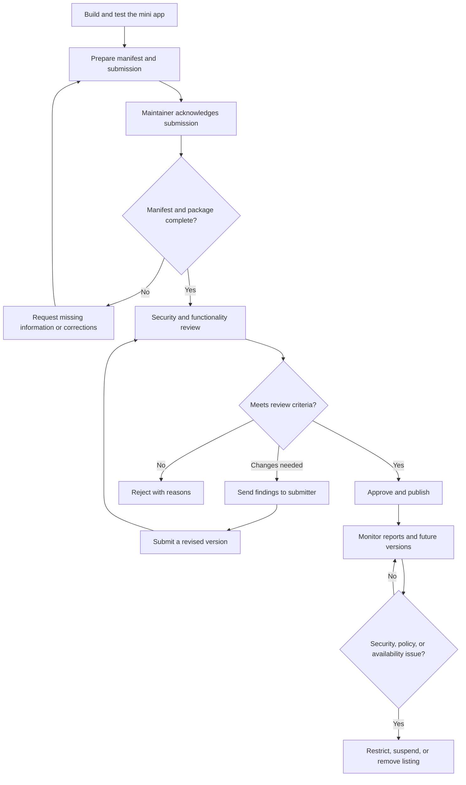

# Mini App Submission Guide

This guide describes how to prepare a Linkora mini app for review, what
maintainers check, and how an approved app is published or removed. The
manifest contract is defined by
[`manifest.schema.json`](./manifest.schema.json).

## Submission at a glance

## 1. Prepare a submission

Before opening a submission:

1. Build and test the app using the Linkora development environment.
2. Include the complete app source or a reproducible build, its hosting URL if
   applicable, and its manifest. Identify the publisher and provide a reliable
   security contact.
3. Document the app's purpose, data handled, external services, and why each
   requested permission is necessary.
4. Open a pull request against the Linkora repository following
   [CONTRIBUTING.md](../../CONTRIBUTING.md). Clearly mark it as a mini-app
   submission and link to the source, hosted entry point, and test/review
   instructions. Do not include credentials, private keys, or user data.

Submitting an app does not guarantee approval or publication. Maintainers may
ask for additional information, changes, or a demonstration before review can
be completed.

## 2. Manifest requirements

The manifest must validate against
[`manifest.schema.json`](./manifest.schema.json). It must be a JSON object with
these required fields:

| Field | Requirement |
| --- | --- |
| `name` | 1–50 characters. |
| `version` | `MAJOR.MINOR.PATCH` numeric semantic version, for example `1.2.0`. The current schema does not accept prerelease or build metadata suffixes. |
| `entryPoint` | String identifying the app page to load. Use a stable HTTPS URL for hosted apps; reviewers verify where it resolves and that it remains on the reviewed origin. |
| `permissions` | Array of unique permission identifiers from the list below. An app should request only what it uses. |

Optional fields are `description` (up to 200 characters) and `icon` (a URL to
the app icon). Additional properties are rejected. Keep metadata accurate and
avoid tracking or promotional claims that are not part of the app's function.

The schema checks the manifest's shape; it does not verify that an entry point
is safe, that the app works, or that a permission is available in every host
version. Reviewers also assess the hosted content and runtime behavior. The
repository's example manifests may use a different, older shape; do not copy
their field names or permissions without converting them to the current schema.

## 3. Permission and sandbox model

A mini app runs as web content in a host-controlled WebView. Its manifest
declares the bridge capabilities it needs; the host must enforce those
capabilities for each bridge call. Declaring a permission is a request, not an
authorization to access arbitrary host functionality. Users must be able to
decline sensitive actions, and a denied or unavailable capability must fail
closed.

The manifest schema currently allows these permissions:

| Permission | Intended capability | Review and user-consent expectation |
| --- | --- | --- |
| `wallet.read` | Read the connected wallet's public address or other explicitly exposed, non-secret wallet information. | Must not expose a seed phrase, private key, signing secret, authentication token, or unrelated wallet data. Ask only for the public data the feature needs. |
| `wallet.sign` | Request a wallet signature for a specific transaction or payload. | Signing must require a clear, fresh user confirmation for the action and show enough detail for the user to understand what they are approving. Rejection must cancel the operation. |
| `profile.read` | Read the minimum public profile information needed by the app. | Must not expose bearer credentials, session tokens, private profile data, or data belonging to another user. |
| `post.create` | Submit content as a Linkora post on the user's behalf. | Show the proposed content and require confirmation before submission. The user must be able to review or cancel it. |

Permission rules:

- Request the smallest set of permissions that supports the stated feature.
  Explain each request in the submission and in the app's user-facing context.
- A permission does not grant arbitrary access to the wallet, profile, posts,
  device, filesystem, or Linkora account. Only documented, host-implemented
  bridge methods should be available.
- Signing and post creation are consequential actions. They require explicit
  confirmation at the time of each action; install-time consent alone is not
  sufficient.
- The app must remain useful without optional permissions where practical and
  must handle denial, cancellation, and unavailable methods without retrying
  silently or misrepresenting success.
- Never request or store a user's seed phrase, private key, password, bearer
  token, or session credential. Never ask users to paste these into the app.
- A declared permission is not proof that a given client release implements
  the corresponding method. The schema and current bridge use different
  permission/method vocabularies in some cases; maintainers must verify the
  mapping in the target host before approving a permission-dependent feature.

The mobile host currently loads the installed entry point in a React Native
WebView, injects the Linkora bridge, and restricts subsequent navigation to
the app's origin. Bridge permissions and host-side approval checks are
separate from the WebView boundary. Treat all app code and dependencies as
untrusted: same-origin navigation is not a substitute for reviewing scripts,
data flows, network requests, and dependency changes. The mini app must not
attempt to escape the host, spoof host UI, or use a different route to obtain
privileged data or actions.

## 4. Security and functionality review

Maintainers review the submitted version, including its manifest, source or
build, entry point, and requested permissions. Review may include static
inspection and running the app in a supported host. Reviewers assess:

- **Identity and purpose:** the publisher and app purpose are clear, and the
  app does what its listing says.
- **Manifest and scope:** the manifest validates; permissions are minimal,
  justified, and supported by the target host.
- **Bridge and consent:** every privileged operation is permission-gated,
  presented accurately to the user, and cancellable where applicable.
- **Security and privacy:** no credential or secret collection, unsafe
  handling of user data, misleading signing/post flows, unexpected network
  transfer, or unnecessary tracking.
- **Content and dependencies:** entry-point origin and redirects are
  appropriate; scripts, third-party services, and dependencies are explained
  and do not introduce unacceptable risk.
- **Reliability and policy:** the app loads, handles errors and denied
  permissions safely, and complies with Linkora's applicable policies and
  applicable law.

Review findings are sent to the submitter with the requested changes or
rejection rationale. A changed permission set, entry point, or security-
relevant behavior may require another review.

### Review targets

For a complete submission, maintainers target:

- An acknowledgement or request for missing information within **5 business
  days**.
- An initial review decision within **10 business days** after the submission
  is complete.

These are service targets, not guaranteed deadlines. Complex security review,
maintainer availability, or time spent waiting for submitter changes can extend
the timeline. If a target is missed, the submitter may ask for a status update
in the pull request.

## 5. Approval, publication, and updates

On approval, maintainers confirm the exact reviewed version and permissions,
then merge and publish it through the Linkora distribution mechanism supported
at that time. A repository merge alone is not a promise that an app is already
available in every Linkora client or catalog; maintainers should communicate
the publication status and supported client versions to the submitter.

Use semantic versions for releases:

- **Patch** (`1.0.1`): compatible fixes that do not change permissions or
  materially change data handling.
- **Minor** (`1.1.0`): backward-compatible features or behavior changes.
- **Major** (`2.0.0`): breaking changes or substantial changes in purpose or
  behavior.

Every published update must include the updated manifest and release notes.
Any change to requested permissions, the entry-point origin, data collection,
signing or posting behavior, or security-sensitive dependencies must be
called out and is subject to renewed review before publication. Do not replace
the content behind a published entry point with materially different behavior
without notifying maintainers and submitting an update.

## 6. Revocation and takedown

Maintainers may restrict, suspend, delist, or reject an app or version when it:

- Has a confirmed or credible security vulnerability, malicious behavior, or
  compromise of its hosting origin.
- Uses permissions or user data beyond what was reviewed, or presents
  misleading signing, posting, or consent flows.
- Violates Linkora policy or applicable law, or is used for fraud, abuse, or
  harmful activity.
- Is persistently unavailable, abandoned in a way that creates user risk, or
  cannot be brought into compliance after requested changes.

For an urgent risk, maintainers may disable or delist the app first and
investigate afterward. Where practical, they will notify the publisher with
the reason, affected version, and remediation or appeal path. The publisher
should promptly report a compromise or vulnerability to the maintainers,
identify affected versions and users where known, and cooperate with mitigation.

Maintainers may restore an app after the issue is resolved and a revised
version passes review. A removed listing does not guarantee that copies already
downloaded or hosted elsewhere are erased; users should be advised to stop
using an affected version where necessary. A publisher who disagrees with a
non-emergency decision may request reconsideration in the submission thread
with supporting evidence.
